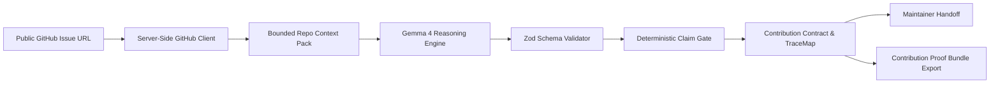

# IssueLift v1.3

> **From Issue URL to a Proven Next Step Before Anyone Edits Code.**  
> *A Hacktoberfest 2026 Submission • Powered by Google Gemma 4 & Deterministic Claim Gate*

[](https://nextjs.org/)
[](https://www.typescriptlang.org/)
[](https://tailwindcss.com/)
[](https://ai.google.dev/gemma)
[](docs/eval-report.md)
[](LICENSE)

---

## 1. The Problem: The Pre-Implementation Alignment Gap

Every Hacktoberfest, enthusiastic contributors find an open issue, spend hours or days writing code, and excitedly submit a pull request—only to receive an immediate rejection or silence.

Why? Because:
1. **Unclear Definition of "Done":** The issue description was vague, and the newcomer made incorrect architectural assumptions.
2. **Missing Test Evidence:** The contributor didn't identify existing test patterns or verify how the project tests that specific requirement.
3. **Burden on Maintainers:** Floods of generic comments (*"Can I work on this?"*) or speculative automated PRs drain maintainer goodwill.

**IssueLift solves this by starting BEFORE anyone edits code.**  
You paste any public GitHub issue URL. IssueLift inspects the issue metadata, fetches the bounded repository tree, and uses Google Gemma 4 combined with a deterministic Claim Gate to compile an evidence-backed **Contribution Contract**, map criteria to real test files, and draft a copy-ready maintainer question.

---

## 2. Interactive Workspace & Pre-Implementation Flow

IssueLift delivers a live, interactive developer workspace organized into five focused stages:

1. **Intake & Bounded Scan:** Paste any public GitHub issue URL. IssueLift validates the issue status, checks for existing PR signals, indexes the repository tree, and safely fetches manifests (`package.json`, lockfiles) and documentation (`README.md`, `CONTRIBUTING.md`).
2. **Setup Truth Ledger:** Extracts verified development, build, test, and install commands directly from package manifests and lockfiles (`pnpm`, `yarn`, `npm`, `bun`, `cargo`, `go`). Commands display exact provenance files rather than AI guesses.
3. **Evidence-Backed Contribution Contract:** Deconstructs issue discussions into discrete criteria (`AC-01`, `AC-02`...). Verbatim requirements retain clickable links to GitHub. AI proposals are quarantined with `AI-PROPOSED` tags and support in-memory editing.
4. **Acceptance-to-Test TraceMap & Gap Radar:** Traverses the entire indexed repository tree without truncation bias. Maps each criterion to verified candidate source files, candidate test files, and substantiated test commands. When no test candidate exists, flags an honest Test Gap with manual reproduction steps.
5. **Deterministic Claim Gate & Proof Bundle:** Enforces strict security invariants: every candidate file path must exist in the repository tree. Hallucinations are rejected and logged in the truth ledger. Exports a verifiable Markdown or JSON Proof Bundle before you write a single line of code.

---

## 3. Signature Product Features

### 3.1 Contribution Contract Compiler
- Derives discrete requirement IDs (`AC-01`, `AC-02`...) from real issue text.
- **Explicit Quotes:** Verbatim issue excerpts are retained and linked directly back to GitHub.
- **AI-Proposed Criteria:** Missing or ambiguous requirements are clearly isolated and labelled `AI-INFERRED`. Never masquerades as maintainer-approved.
- **In-Memory Editing:** Contributors can edit criteria or toggle *"Needs Clarification"* in real time without database overhead.

### 3.2 Acceptance-to-Test TraceMap & Test Gap Radar
- **4-Node Evidence Chains:** Maps each criterion:  
  `Criterion (AC-XX) → Candidate Source File → Candidate Test File → Documented Test Command`
- **Solid vs. Dashed Links:** Solid links for verified-existence files in the repository tree; dashed links for AI-inferred relevance.
- **Test Gap Radar:** When bounded scan identifies no automated test candidate, IssueLift explains what was checked, why uncertainty exists, and suggests a manual reproduction scenario. It **never** claims "no tests exist" in the repository or invents false coverage percentages.

### 3.3 Deterministic Claim Gate & Truth Ledger
- **Core Invariant:** *Gemma proposes; deterministic code verifies.*
- Validates that every candidate file path exists in the fetched GitHub tree.
- Hallucinated paths or fabricated source IDs are rejected, demoted to `UNKNOWN`, and logged in the audit ledger.
- Zero repository code execution on the server.

### 3.4 Copy-Ready Maintainer Handoff
- Drafts a concise, respectful clarification comment grounded in the actual issue ambiguity.
- Suggests concrete acceptance-criteria additions for maintainer approval.
- **Never auto-posts:** The contributor edits and copies the markdown to clipboard manually.

### 3.5 Downloadable Contribution Proof Bundle
- Generates a self-contained, verifiable Markdown export artifact (`.md`) or structured JSON (`.json`) matching the current on-screen state.

### 3.6 Open ProofBench Suite (7 Labelled Fixtures)
- 100% offline, deterministic benchmark in `eval/fixtures/` validating Claim Gate invariants.
- Runs without an API key: `npm run eval:proofbench`.

---

## 4. Why Does Open Innovation Matter?

> **IssueLift turns an open issue into a reviewable Contribution Contract and evidence-to-test map before coding begins. The deterministic Claim Gate can be inspected and improved; the public ProofBench lets contributors add counterexamples whenever a path, citation, requirement or test-evidence label is wrong. This makes reliability rules—not only UI code—open to community inspection and extension. We claim no impact numbers until measured.**

### Community Participation Without Retraining Models
In proprietary AI tools, reliability failures are hidden behind opaque confidence scores. With IssueLift, reliability rules are open to everyone:
1. **Inspectable Guardrails:** The validation code in [`src/lib/claim-gate.ts`](src/lib/claim-gate.ts) is open-source.
2. **Community Counterexamples:** Anyone can add a new edge-case fixture in `eval/fixtures/` without machine learning infrastructure.
3. **Sustainable Open Source:** Higher signal for maintainers, less wasted effort for newcomers.

---

## 5. Architecture & Data Flow



Detailed architectural specifications, threat models, and validation invariants are documented in [docs/architecture.md](docs/architecture.md).

---

## 6. Competitive Reality & Market Positioning

| Tool | Category | What IssueLift Does NOT Copy | IssueLift Pre-Edit Positioning |
| :--- | :--- | :--- | :--- |
| **GoodFirst** | Beginner issue picker | No issue directory or chatbot | Starts **after** issue is picked; compiles pre-edit contract |
| **IssueScout** | Issue search & score | No arbitrary difficulty percentages | Deterministic **Readiness Gate** (`ACTIONABLE` / `CLARIFY FIRST`) |
| **Ossistant** | Open source AI chat | No free-form conversational chat | Verifiable, evidence-linked **Proof Bundle** artifacts |
| **CodeRabbit** | Post-PR code review | Does not operate post-PR | **Pre-PR alignment**: agree on "done" before coding begins |
| **GitHub Copilot / SWE-agent** | Autonomous coding agent | Does not auto-create PRs or execute code | Empowers **human newcomers** with verified truth trails |

*See [docs/competitive-audit.md](docs/competitive-audit.md) for full competitive analysis.*

---

## 7. Prerequisites & Quick Start

### Prerequisites
- Node.js `v18.17+` or `v20+` (tested on Node.js v24)
- npm `v9+` or `v10+`
- Git

### Installation & Local Run
```bash
# 1. Clone repository
git clone https://github.com/rudraarcadeskills-art/IssueLift.git
cd IssueLift

# 2. Install dependencies
npm install

# 3. Configure local environment (Optional for AI reasoning; baseline works out-of-the-box)
cp .env.local.example .env.local

# 4. Start development server
npm run dev
```

Open [http://localhost:3000](http://localhost:3000) in your browser.

---

## 8. One-Step Gemma 4 API Key Configuration

IssueLift runs out-of-the-box with its deterministic baseline compiler. To activate real Google Gemma 4 analysis:

1. Visit [Google AI Studio](https://aistudio.google.com/apikey) and copy your free-tier key.
2. Edit `.env.local` in the project root:
   ```bash
   GEMMA_API_KEY=your_copied_api_key_here
   GEMMA_MODEL=gemma-4-26b-a4b-it
   # Optional: GITHUB_TOKEN=your_github_token_for_rate_limits
   ```
3. Restart the server. The status indicator will flip to **Live Gemma 4**.
*Note: Never prefix with `NEXT_PUBLIC_`. Keep `.env.local` strictly server-side and ignored by Git.*

---

## 9. Verification & Testing Commands

```bash
# Run unit and regression test suite
npm test

# Run deterministic ProofBench evaluation suite (7/7 fixtures, zero API key required)
npm run eval
# (or: npm run eval:proofbench)

# Verify TypeScript types
npm run typecheck

# Verify production Next.js build
npm run build

# Generate editable presentation deck
npm run generate:pptx
```

---

## 10. Submission Artifacts & Links

- **QA Verification Report:** [docs/qa-report.md](docs/qa-report.md)
- **ProofBench Evaluation Report:** [docs/eval-report.md](docs/eval-report.md)
- **Rubric Compliance Matrix (All 9 Criteria):** [docs/rubric-compliance.md](docs/rubric-compliance.md)
- **60–90 Second Demo Script:** [docs/demo-script.md](docs/demo-script.md)
- **Newcomer Task Roadmap:** [docs/newcomer-roadmap.md](docs/newcomer-roadmap.md)
- **Editable Presentation Deck:** [submission/IssueLift_Submission.pptx](submission/IssueLift_Submission.pptx) (251 KB, 8 widescreen slides including "Why Does Open Innovation Matter?")

---

## 11. Zero-Budget & Security Guardrails

- **Zero Billing:** Runs entirely within free-tier limits (Google AI Studio Gemma 4 free tier + unauthenticated public GitHub REST API).
- **No Database / Login:** Operates in-memory with zero persistent user tracking.
- **Zero Remote Code Execution:** Untrusted repository scripts are never executed on the host.

---

## 12. License

Original application code, Claim Gate validators, and ProofBench fixtures are released under the [MIT License](LICENSE).  
Google Gemma model weights are governed by Google's [Gemma Terms of Use](https://ai.google.dev/gemma/terms).
